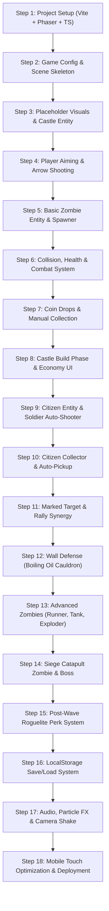

# Zombie Castle Defense: Master Blueprint & AI Build Roadmap

A browser-based action/strategy defense game where players defend a castle against zombie hordes by shooting arrows, deploying active defenses, commanding citizen defenders, and expanding their fortress.

---

## 1. Vision & Core Philosophy

- **One-Line Pitch:** Defend your castle from scaling zombie waves by shooting precision arrows yourself, commanding specialized citizen defenders, deploying tactical traps, and adapting with post-wave roguelite perks.
- **Platform:** Web browser (Desktop mouse/keyboard + Mobile touch-friendly), deployed via Vite on Vercel.
- **Active vs. Passive Balance:**
  - *Early Waves:* Citizen soldiers and auto-collectors can handle the bulk of weak zombies.
  - *Mid/Late Waves & Bosses:* The player must actively prioritize targets, trigger focus fire, pour boiling oil, and snipe high-threat siege/exploder zombies.
- **Core Loop:**
  `Day Preparation / Build Phase` ➔ `Night Zombie Horde Battle` ➔ `Tactical Combat & Emergency Defenses` ➔ `Coin Collection & Wave Victory` ➔ `Choose 1 of 3 Roguelite Perks` ➔ `Base Upgrades & Citizen Training` ➔ `Repeat with escalating threat`.

---

## 2. Tech Stack

| Layer | Technology | Reason |
|---|---|---|
| **Language** | TypeScript (strict mode) | Strong typing prevents state/data bugs across citizen roles, ranks, and upgrades. |
| **Game Engine** | Phaser 3 | Industry-standard 2D web engine with physics, sprite batches, input handling, and sound. |
| **Build Tool** | Vite | Instant HMR development server and optimized production bundles. |
| **Persistence** | `localStorage` (v1) | Zero-backend state persistence with schema validation and fallback defaults. |
| **Deployment** | Vercel / GitHub Pages | Automated CI/CD static hosting. |

---

## 3. Core Mechanics & Synergies

### 3.1 Player Actions & Synergy Mechanics
- **Aim & Shoot:** Tap/click anywhere to loose an arrow with trajectory/velocity toward the cursor/finger.
- **Marked Target (Focus Fire):** When the player manually hits an enemy with a precision headshot or critical strike, that enemy receives a visible "Marked" banner. All citizen archers instantly prioritize and focus-fire that target with +30% attack speed.
- **Rally War Horn:** An active player skill (30s cooldown). Sounding the horn gives all defenders +50% fire rate and +20% movement speed for 5 seconds.
- **Boiling Oil / Cauldron:** An emergency castle-wall defense. The player clicks/taps the oil pot on the gate to pour molten oil onto clustered zombies directly beneath the wall, dealing heavy continuous fire damage.
- **Fast-Forward & Pause:** 1x / 2x speed toggle and emergency pause for strategic decision-making.

### 3.2 Castle Defenses & Buildings
| Building / Structure | Purpose | Unlock Wave |
|---|---|---|
| **Castle Walls & Gate** | Blocks zombies. Has a health bar. If destroyed, the castle falls. | Wave 1 |
| **Boiling Oil Cauldron** | Reusable wall ability with a cooldown. Melts gate crowds. | Wave 2 |
| **House / Quarters** | Increases citizen population cap (+2 citizens per level). | Wave 1 |
| **Barracks** | Enables citizens to become Soldiers. | Wave 2 |
| **Training Grounds** | Promotes soldiers to higher ranks (Rookie ➔ Captain ➔ Major ➔ Archer). | Wave 3 |
| **Spike Barricades** | Deployable ground traps outside the gate that slow and damage runners. | Wave 4 |
| **Kitchen / Mess Hall** | Feeds citizens; fed citizens perform with full stats and high morale. | Wave 5 |
| **Hospital / Infirmary** | Automatically nurses injured citizens back to health. | Wave 7 |

---

## 4. Citizen System: Ranks, Roles & Morale

### 4.1 Roles
Every citizen can be reassigned between waves into one of three roles:
1. **Soldier:** Mans the castle battlements, auto-targeting approaching zombies with ranged arrows.
2. **Collector:** Dashes outside the gate to automatically gather coins and resources dropped by fallen zombies.
3. **Explorer:** Ventures farther out during Day phases to discover rare treasure chests and crafting materials (carries risk of being ambushed).

### 4.2 Soldier Ranks & Stat Progression
`Rookie` ➔ `Captain` ➔ `Major` ➔ `Archer (Elite)`

| Rank | Accuracy | Range | Damage | Attack Rate | Special Trait |
|---|---|---|---|---|---|
| **Rookie** | 60% | Short | 5 | 1.0s | Cheap, panics if gate health < 25%. |
| **Captain** | 80% | Medium | 12 | 0.8s | Rallies nearby Rookies, preventing panic. |
| **Major** | 92% | Long | 24 | 0.6s | Fires piercing arrows that strike 2 targets. |
| **Archer** | 98% | Extreme | 45 | 0.4s | Multi-shot (fires 2 arrows simultaneously). |

---

## 5. Zombie Bestiary & Threat Types

| Zombie Type | Movement | HP | Damage to Gate | Tactical Threat & Behavior |
|---|---|---|---|---|
| **Walker** | Medium (50 px/s) | 20 | 5 / hit | Standard fodder. Spawns in groups. |
| **Runner** | Fast (120 px/s) | 12 | 3 / hit | Swarms quickly; high priority for barricades and collectors. |
| **Tank** | Slow (25 px/s) | 120 | 25 / hit | Bullet sponge; absorbs arrow fire. High priority for "Marked Target". |
| **Exploder (Bloater)** | Medium (60 px/s) | 35 | 80 (Explosion) | Rushes the gate and self-destructs. Player *must* snipe before it reaches the wall. Killing it mid-field damages surrounding zombies. |
| **Siege Catapult Zombie** | Immobile / Far | 90 | 15 (Ranged) | Hurls boulders at walls from outside citizen range. Requires manual player sniping. |
| **Wave Boss (W5, W10)** | Slow | 500+ | 50 / hit | Giant multi-phase boss with special abilities (stomp, minion summon). |

### Scaling Formulas:
```
Wave Zombie Count  = 6 + (waveNumber * 3)
Zombie Base HP     = 15 * (1 + (waveNumber - 1) * 0.18)
Zombie Base Damage = 3 * (1 + (waveNumber - 1) * 0.14)
```

---

## 6. Roguelite Perks & Permanent Upgrades

### 6.1 End-of-Wave Roguelite Perks (Choose 1 of 3 each victory)
- **Bouncing Arrows:** Player arrows ricochet to 1 additional target for 50% damage.
- **Explosive Impact:** Manual arrow headshots create a small area-of-effect blast.
- **Adrenaline Rush:** Castle wall under 30% health boosts all archer fire rate by 100%.
- **Swift Harvesters:** Collectors move 40% faster and gain temporary damage immunity.
- **Greedy Scavenger:** All coin drops yield +25% bonus value.
- **Volley Fire:** Every 5th player shot fires a fan of 3 arrows.

### 6.2 Permanent Base Upgrades (Purchased in Build Phase)
- **Arrow Strike Power:** Flat damage increase for player shots.
- **Recurve Bow:** Faster draw time and projectile velocity.
- **Reinforced Masonry:** Increases castle wall max HP and auto-repair rate.
- **Coin Magnet:** Expands player auto-collection radius around the castle.

---

## 7. Project Architecture & Directory Structure

```
zombie-castle/
├── index.html
├── package.json
├── tsconfig.json
├── vite.config.ts
├── public/
│   └── assets/                     # Sprites, SFX, background music
└── src/
    ├── main.ts                     # Phaser 3 Game initialization
    ├── config.ts                   # Screen resolution, physics, global settings
    ├── scenes/
    │   ├── BootScene.ts            # Asset loading & progress bar
    │   ├── MenuScene.ts            # Start game, continue, settings
    │   ├── CastleScene.ts          # Build phase, citizen training, shop
    │   ├── BattleScene.ts          # Main defense combat arena
    │   ├── PerkScene.ts            # Post-wave 3-card roguelite selection modal
    │   └── GameOverScene.ts        # Victory / Defeat stats & restart
    ├── entities/
    │   ├── Castle.ts               # Gate health, boiling oil, visual damage states
    │   ├── Arrow.ts                # Player & citizen projectiles with physics
    │   ├── Citizen.ts              # Soldiers, collectors, state machine, AI
    │   ├── Zombie.ts               # Zombie base class + specialized subclasses
    │   └── Coin.ts                 # Dropped currency with physics & pickup detection
    ├── systems/
    │   ├── WaveManager.ts          # Spawning schedule, scaling math, composition
    │   ├── CombatManager.ts        # Hit registration, marked target, synergies
    │   ├── EconomyManager.ts       # Coin balances, purchases, rewards
    │   └── SaveManager.ts          # LocalStorage serialization & error recovery
    ├── data/
    │   ├── balance.ts              # All tweakable numbers (HP, costs, speeds)
    │   ├── perks.ts                # Perk pool definitions & modifiers
    │   └── levels.ts               # Level configurations and wave compositions
    └── ui/
        ├── HudOverlay.ts           # Wall HP, active cooldowns, coin count, wave #
        ├── CardSelector.ts         # Roguelite 3-choice perk card UI
        └── BuildingMenu.ts         # Citizen management and upgrade shop panels
```

---

## 8. Master Sequential AI Implementation Plan (Step 1 to Step 18)

> **Instructions for AI Execution:**
> Build the game **strictly in order** from Step 1 to Step 18. Each step has clear file deliverables and a verification checkpoint. Never start the next step until the previous checkpoint passes.



---

### Step 1: Project Setup & Environment
- **Goal:** Initialize Vite + TypeScript project and install Phaser 3.
- **Tasks:**
  1. Initialize `package.json` with dependencies: `phaser` (v3.80+), `typescript`, `vite`.
  2. Configure `tsconfig.json` with strict TypeScript checks.
  3. Configure `vite.config.ts` for clean local dev server and static output.
  4. Create `index.html` with responsive viewport container `#game-container`.
- **Verification:** Run `npm run build` and `npm run dev` to verify clean compilation with zero warnings.

### Step 2: Game Configuration & Scene Skeleton
- **Goal:** Set up Phaser 3 instance and basic scene navigation.
- **Tasks:**
  1. Create `src/config.ts` (1280x720 16:9 virtual canvas, Phaser.AUTO, Arcade Physics).
  2. Create `src/main.ts` loading 6 scene stubs: `BootScene`, `MenuScene`, `CastleScene`, `BattleScene`, `PerkScene`, `GameOverScene`.
  3. Wire simple transitions: `Boot` ➔ `Menu` ➔ `Battle`.
- **Verification:** Browser loads with black/colored canvas and transitions between scenes without errors.

### Step 3: Base Arena & Castle Wall Entity
- **Goal:** Render the battleground, ground line, and Castle Wall with a functional health pool.
- **Tasks:**
  1. In `BattleScene.ts`, draw the ground plane and sky background using Phaser primitive graphics.
  2. Implement `src/entities/Castle.ts` positioned on the left side of the screen.
  3. Give Castle a health property (`maxHealth`, `currentHealth`) and render a visible green/red health bar above the gate.
  4. Trigger a `game-over` event when Castle health drops to 0.
- **Verification:** Castle displays on screen with full health bar; programmatically reducing health updates the bar and triggers game over.

### Step 4: Player Aiming & Arrow Ballistics
- **Goal:** Allow the player to tap or click anywhere on screen to launch an arrow from the castle.
- **Tasks:**
  1. Implement `src/entities/Arrow.ts` using Arcade physics (velocity, angle rotation along trajectory).
  2. Add pointer input listener in `BattleScene.ts`: on click/pointerdown, calculate angle from Castle to pointer and spawn an Arrow with fixed speed.
  3. Destroy arrows when they leave screen bounds or hit the ground.
- **Verification:** Clicking anywhere shoots an arrow from the castle towards the cursor with accurate rotation.

### Step 5: Basic Zombie Entity & Spawning
- **Goal:** Spawn standard Walker zombies that march from the right towards the castle.
- **Tasks:**
  1. Implement `src/entities/Zombie.ts` with properties: `hp`, `speed`, `damage`, `isDead`.
  2. Give zombies a walking velocity to the left (`-vx`).
  3. Implement simple wave spawner: spawns 5 Walkers sequentially over 10 seconds.
  4. When a zombie reaches the Castle wall, stop its movement and make it attack the wall periodically (e.g. 1 hit per second).
- **Verification:** Zombies spawn on the right, walk to the castle, stop at the gate, and damage castle health over time.

### Step 6: Collision Detection & Combat Resolution
- **Goal:** Arrow projectiles strike zombies, deal damage, and defeat them.
- **Tasks:**
  1. Add Arcade Physics collider/overlap between `Arrow` group and `Zombie` group.
  2. When an arrow hits a zombie: subtract arrow damage from zombie HP, produce a brief white damage flash, and destroy the arrow.
  3. When zombie HP reaches 0: play death animation/fade-out and remove from active group.
- **Verification:** Arrows visibly damage and destroy walking zombies before they reach the gate.

### Step 7: Economy Basics (Coin Drops & Collection)
- **Goal:** Slain zombies drop collectible coins.
- **Tasks:**
  1. Implement `src/entities/Coin.ts` with gentle bounce physics on spawn.
  2. When a zombie dies, spawn 1–3 coins at its position.
  3. Player can click/tap directly on a coin to collect it.
  4. Create `src/systems/EconomyManager.ts` tracking current coins and updating a HUD coin counter.
- **Verification:** Defeated zombies spawn coins; clicking them increments the coin counter on the HUD.

### Step 8: Build Phase (CastleScene) & Upgrade Shop
- **Goal:** Transition to the CastleScene between waves to spend coins on base upgrades.
- **Tasks:**
  1. Implement `CastleScene.ts` displaying: Castle preview, current wave number, coin stash, and "Start Next Wave" button.
  2. Add upgrade buttons:
     - Upgrade Arrow Damage (costs coins, increases player arrow damage).
     - Repair Castle Gate (costs coins, restores missing wall HP).
     - Upgrade Wall Max HP (costs coins, increases maximum wall health).
  3. Integrate `src/systems/EconomyManager.ts` to validate affordability and deduct coins.
- **Verification:** Player can earn coins in wave 1, enter CastleScene, buy an upgrade, and see enhanced stats in wave 2.

### Step 9: Citizen Entity & Soldier Auto-Shooters
- **Goal:** Add citizen defenders stationed on the castle wall that automatically shoot incoming zombies.
- **Tasks:**
  1. Implement `src/entities/Citizen.ts` with role `Soldier` and rank `Rookie`.
  2. Position citizen sprites on top of the castle battlements.
  3. Implement soldier auto-targeting: search for the closest zombie within range, calculate firing trajectory, and shoot an arrow at a fixed interval.
  4. Allow purchasing additional citizens in `CastleScene.ts` (subject to House population cap).
- **Verification:** Stationed soldier citizens automatically aim and shoot arrows at approaching zombies without player clicks.

### Step 10: Citizen Collector & Auto-Pickup Loop
- **Goal:** Allow assigning citizens to the `Collector` role to gather coins automatically.
- **Tasks:**
  1. In `CastleScene.ts`, add role-toggle UI to assign a citizen between `Soldier` and `Collector`.
  2. In `BattleScene.ts`, Collector citizens spawn at the castle gate, run towards dropped coins on the field, pick them up, and return safely to the gate.
  3. Add basic safety logic: Collectors retreat if a zombie gets within melee range.
- **Verification:** Dropped coins are automatically fetched by Collector citizens without requiring player taps.

### Step 11: Synergy Mechanics (Marked Target & Rally Horn)
- **Goal:** Add active player abilities that directly boost citizen performance.
- **Tasks:**
  1. Implement **"Marked Target"**: Player critical hits / manual clicks place a visual marker on an enemy. Soldier citizens override default targeting to focus fire on this marked enemy with +30% attack speed.
  2. Implement **"Rally War Horn"**: Add HUD horn button with 30s cooldown. When triggered, plays horn sound, displays aura on citizens, and boosts their fire rate by 50% for 5 seconds.
- **Verification:** Marking a zombie redirects all soldiers to attack it immediately; pressing the horn button doubles defender firing animations and output.

### Step 12: Active Castle Defense (Boiling Oil Cauldron)
- **Goal:** Give the player an emergency defense against zombies swarming the gate.
- **Tasks:**
  1. Add Cauldron sprite above the gate with a ready/recharging cooldown state (20s cooldown).
  2. Clicking the ready cauldron pours a fiery oil animation directly down the front of the gate.
  3. Create an area-of-effect damage zone at the gate base lasting 4 seconds that burns any zombie standing in it.
- **Verification:** Clicking the cauldron triggers oil pour and rapidly eliminates swarms piled against the castle gate.

### Step 13: Specialized Zombie Threats (Runner, Tank, Exploder)
- **Goal:** Introduce behavioral variety to zombie hordes.
- **Tasks:**
  1. Create `Runner`: moves 2.5x faster than normal zombies, low health.
  2. Create `Tank`: moves slowly, high health pool, visually 1.5x larger.
  3. Create `Exploder (Bloater)`: red glowing zombie. When killed or when reaching the gate, detonates in a large radius. Detonation near the gate deals severe damage; detonation in the field damages neighboring zombies.
- **Verification:** Exploder can be sniped in the field to blow up a pack of runners; Tanks require focused archer fire.

### Step 14: Siege Catapult Zombie & Level 5 Boss
- **Goal:** Implement long-range enemy threats and a milestone multi-phase boss.
- **Tasks:**
  1. Create `Siege Zombie`: stops at screen edge (out of citizen range) and fires rock projectiles toward the wall every 4 seconds. Requires manual player sniping.
  2. Create `BossZombie` for Wave 5: large sprite, health bar at top of screen, phases:
     - Phase 1: High armor walk.
     - Phase 2 (50% HP): Enrages, summons a wave of Runners.
- **Verification:** Siege zombie fires from afar until sniped; Wave 5 boss triggers multi-phase fight with enrage mechanics.

### Step 15: Post-Wave Roguelite Perk System (PerkScene)
- **Goal:** Present 3 randomized perk cards after winning each wave.
- **Tasks:**
  1. Create `src/data/perks.ts` containing perk definitions (Bouncing Arrows, Explosive Blast, Last Stand, Volley Fire, Swift Harvesters).
  2. Implement `PerkScene.ts` as an overlay modal displaying 3 randomly selected cards from the pool.
  3. Selecting a card applies its modifier to `CombatManager` or `EconomyManager` for the remainder of the run.
- **Verification:** Clearing a wave displays 3 distinct perk cards; selecting one immediately applies its mechanical effect in the next wave.

### Step 16: LocalStorage Save & Load System
- **Goal:** Persist player progress and upgrades between browser refreshes.
- **Tasks:**
  1. Implement `src/systems/SaveManager.ts` with interface `SaveData`:
     - Current wave, coin count, purchased upgrades, citizen roster (ranks and roles), active perks.
  2. Auto-save after completing each wave and after every store purchase.
  3. On launch, check `localStorage`; display "Continue" button in `MenuScene` if valid save exists.
  4. Wrap in try/catch with corrupted-save detection and graceful reset.
- **Verification:** Refreshing the browser mid-campaign allows clicking "Continue" and restoring exact wave, coins, citizens, and perks.

### Step 17: Audio, Particle FX & Screen Polish
- **Goal:** Transform basic graphics into a responsive, juicy game feel.
- **Tasks:**
  1. Add sound effects (arrow whoosh, arrow hit thud, zombie groan, coin clink, horn blow, oil sizzle, victory fanfare).
  2. Add floating text for damage numbers and coin pickups (+10).
  3. Add particle emitters: blood splatters on zombie hit, sparks on gate hit, fire particles for boiling oil.
  4. Add subtle screen shake on Exploder detonations and boss stomps.
- **Verification:** Combat feels tactile, responsive, and audible with visual feedback on every hit.

### Step 18: Mobile Touch Optimization & Deployment
- **Goal:** Ensure smooth performance on mobile phones and deploy to web.
- **Tasks:**
  1. Configure touch event listeners alongside mouse clicks.
  2. Add auto-aim assist toggle in settings (snaps player aim to closest threat if on touch devices).
  3. Ensure UI buttons and upgrade cards are at least 48px touch targets.
  4. Run production build `npm run build` and verify bundle size < 2MB.
  5. Deploy to Vercel/GitHub Pages.
- **Verification:** Game runs smoothly at 60 FPS on both mobile phone touchscreens and desktop browsers.

---

## 9. Data Schemas (TypeScript)

```ts
export type CitizenRole = 'soldier' | 'collector' | 'explorer';
export type SoldierRank = 'rookie' | 'captain' | 'major' | 'archer';
export type ZombieType = 'walker' | 'runner' | 'tank' | 'exploder' | 'siege' | 'boss';

export interface CitizenData {
  id: string;
  name: string;
  role: CitizenRole;
  rank: SoldierRank;
  level: number;
}

export interface PlayerStats {
  coins: number;
  currentWave: number;
  wallMaxHp: number;
  wallCurrentHp: number;
  arrowDamage: number;
  arrowSpeed: number;
  bowFireRate: number;
  unlockedPerks: string[];
  citizens: CitizenData[];
}

export interface PerkCard {
  id: string;
  name: string;
  description: string;
  icon: string;
  rarity: 'common' | 'rare' | 'legendary';
  apply: (stats: PlayerStats) => void;
}
```

---

## 10. Golden Rules for the Implementing AI

1. **Follow the Steps in Numerical Order (1 ➔ 18):** Do not skip ahead or implement complex features before their dependencies exist.
2. **Keep Data Separate from Logic:** All stats, costs, HP values, and wave compositions belong in `src/data/`, never hardcoded into entity classes.
3. **Use Simple Geometry First, Assets Second:** Ensure full mechanical fun using colored shapes and geometric placeholders before loading external sprite sheets.
4. **Never Break Mobile Viewport:** Always scale canvas through Phaser's `Scale.FIT` inside a responsive CSS wrapper.
5. **Preserve State Integrity:** Always update `SaveManager` on critical state mutations (wave clear, building upgrade, perk pick).
